# Changelog

## Workshop, warehouse and fleet share one workspace · 16 November 2026

**[BauFlow Musterbau](https://bauflow-production-1344.up.railway.app/muster)** and **[RheinRuhr Kranservice Muster](https://rheinruhr-kran-muster-production.up.railway.app/muster)** now open these areas beneath the same team and icon navigation. Continuous rooms, compact Day/Night glass, expandable search and existing detail cards preserve each company's identity and records.

PR226 runs as `d174709`; PR227 as `84048b1`. 35 online checks passed across desktop and emulated phone, Light/Night, including search, details, focus, natural footer and denied warehouse access for field staff. AL-Steel, BaumdienstFlow and other demos were not redeployed or changed. Evidence and limits.

Actual online captures with fictional demo data only · 16 November 2026.

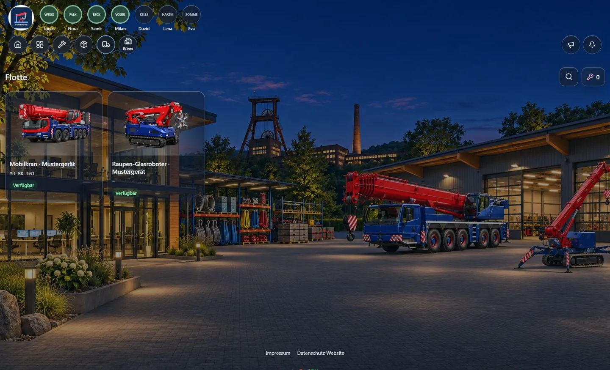

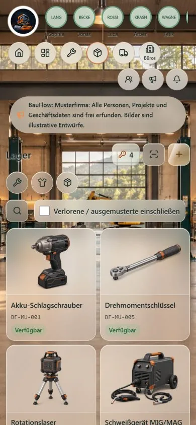

## Separate crane sample company is online · 15.11.2026

**[Open RheinRuhr Kranservice · MUSTER](https://rheinruhr-kran-muster-production.up.railway.app/muster)** — another fictional company from the BauFlow base: seven staff, three lifting jobs, two machines, four tools and three offices. Manufacturing is disabled. Owner, accounting, dispatch, field staff and workshop use distinct accounts and the existing permissions. Changes and documents persist in its own database; use test data only.

PR223 plus publication adapter PR224, runtime `a2a5829`: 1,314 unit tests, 36 local and 42 online browser cases passed. An uploaded PDF survived redeployment and was downloaded from an independent employee session. AL-Steel, BauFlow Musterbau and BaumdienstFlow retain their existing independent deployments. AI, email, GPS and engineering lifting-plan approval are not connected here. [Release and exact limits](CRANE_MUSTER.md).

Actual online captures with fictional data · 15 November 2026. The phone viewport is emulated; images are illustrative samples, not technical job approval.

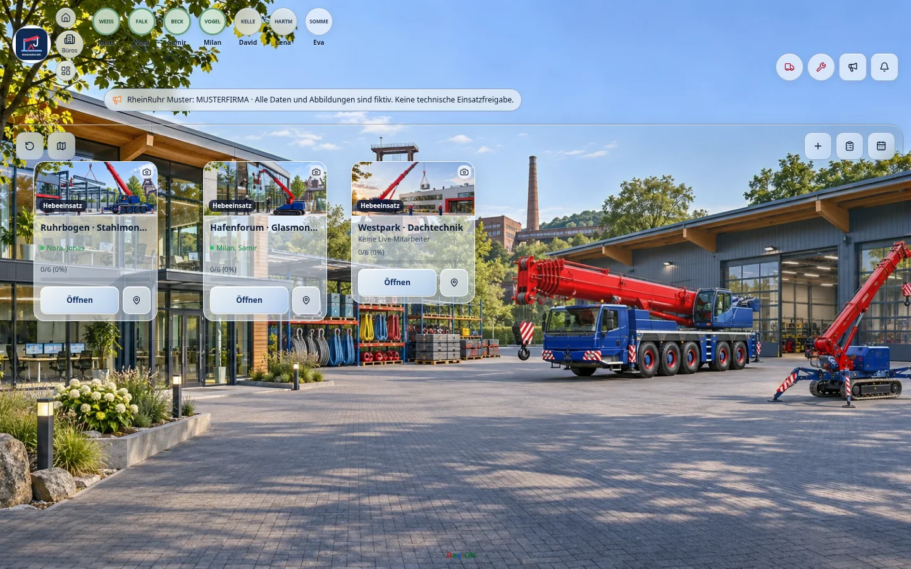

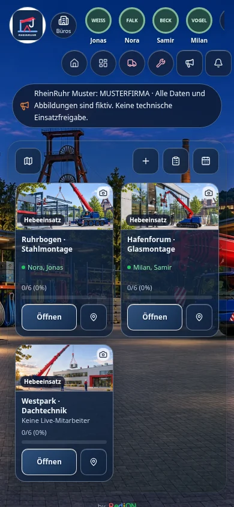

## BauFlow sample company is online · 14.11.2026

The separate **[BauFlow Musterbau · DEMO](https://bauflow-production-1344.up.railway.app/demo)** runs the current steel application with its own original BauFlow identity. Choose owner, accounting, site, factory or workshop at entry. Twelve fictional employees, five offices, three sites, one factory and eleven assets (six vehicles and five tools) share the same connected workflows. Changes persist and are visible to other testers; use test data only. AL-Steel and BaumdienstFlow keep their independent deployments.

Release, access and verification. Initial PR206 release: `67cd096`; 1,265 unit tests and 45 browser cases passed. The following are actual online captures from 14 November, with fictional data. Phone views are responsive/emulated, not physical-device acceptance.

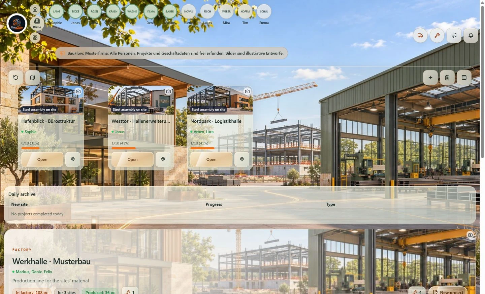

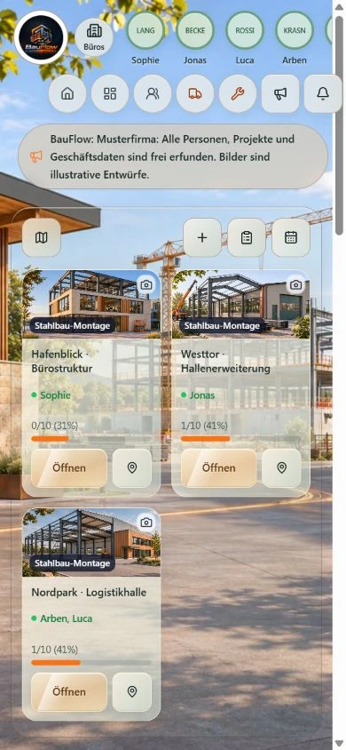

The fleet now uses clear Day/Night glass with six photographed sample vehicles, including a crane truck and site-manager estate car. PR211 is live only on the independent Musterfirma demo. Existing uploaded photos, original vehicle records and repair history are preserved.

Actual online UI with fictional data and illustrative vehicle images · 14 November 2026.

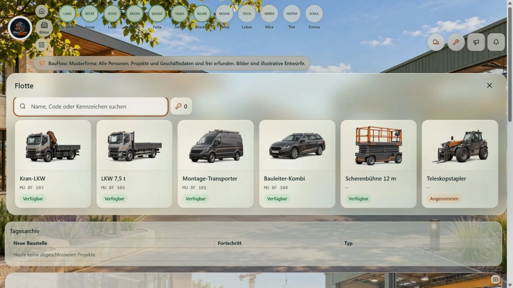

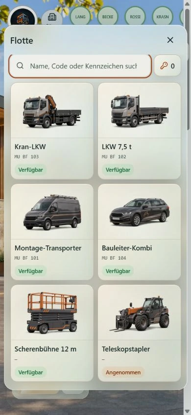

The inventory now shares the compact Day/Night glass cards with five illustrated tools. PR212 is live only on the separate Musterfirma demo; identities, barcodes, custody and the existing repair are preserved.

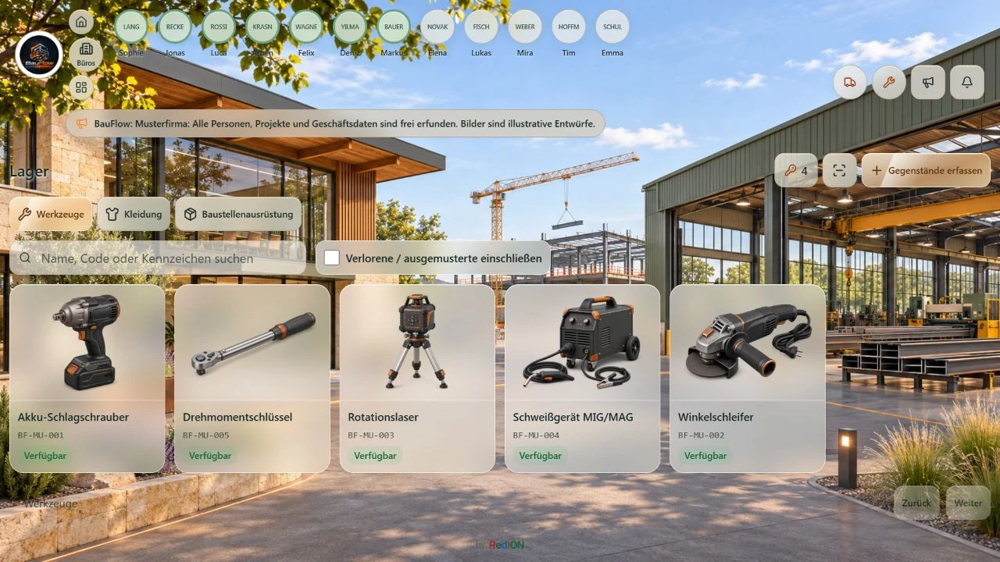

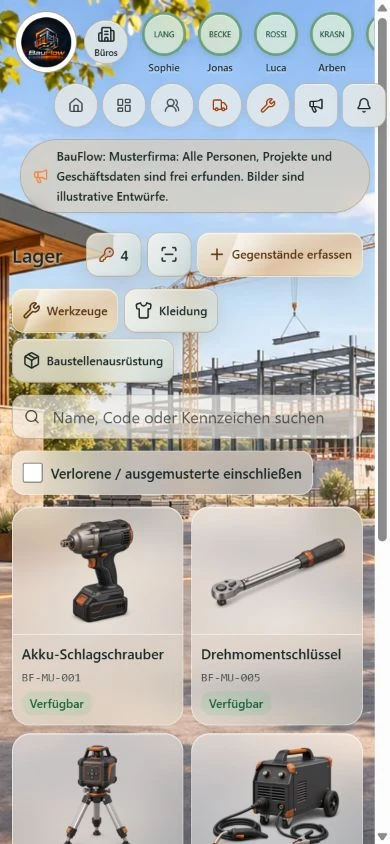

## Musterfirma: photoreal tree references · 15 November 2026

Tree cards keep their fixed size and flip for completion/problem actions. Filters no longer share a decorative white band; scrolling remains available with hidden scrollbar chrome. Cards and the atlas share 26 generated photorealistic summer, autumn and winter species references. These are illustrations of a species, not photographs of individual site trees.

Long tree lists mount a bounded visible window. Large inventory and timber collections use the same approach while retaining existing data limits and workflows. Source and verification: PR217. Live on Musterfirma only: source `99c69ee`, Railway `53240831-27cb-4988-aed4-cd733ca44ec8`, SUCCESS/Online. 62 browser flows verified; 727 unit tests and 19 mocked integration cases passed. Existing data and configuration were preserved.

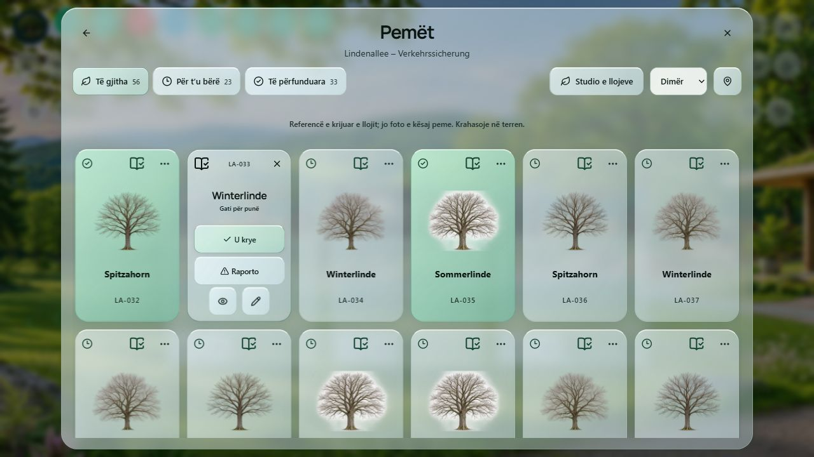

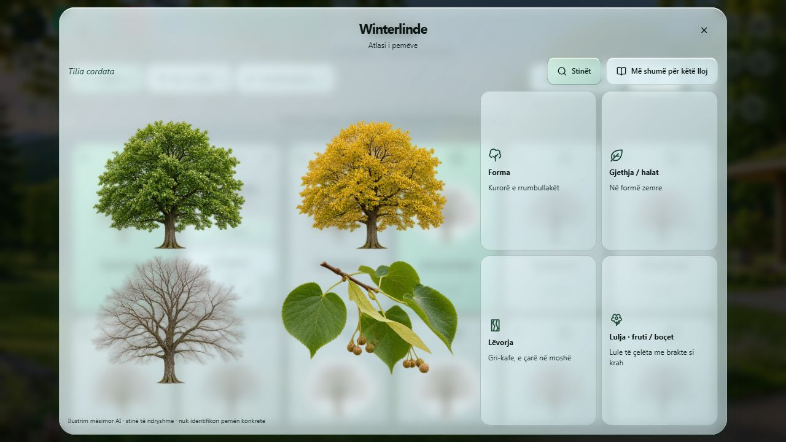

## Musterfirma: glass worksite cards · 14 November 2026

The public BaumdienstFlow Musterfirma demo now opens worksites as glass cards over the existing Workzone, with a centered name, address and site information. An illustrated tree card opens a dedicated view with **All / To do / Completed**, map and species studio. Equipment, crew, safety, photos, processes, documents and instructions open separate views.

[Open the live worksite card](https://redionflow-production.up.railway.app/demo/baustellen/cmw5rbbq1000o2kk19w9m2apf). The current captures below show the demo interface with fictional data. This release preserves the existing records/files and does not change other products' company access. Source: a7093cf, PR205.

Current views from 15 November 2026 use photoreal tree references and the same glass style. The phone capture uses fictional, read-only demo data.

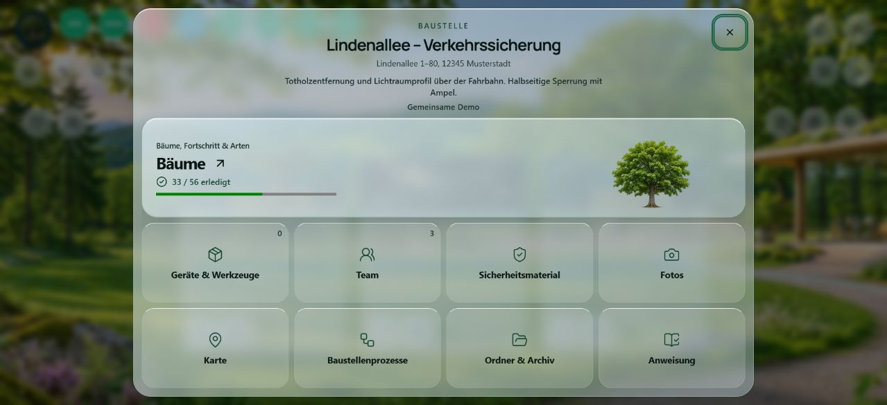

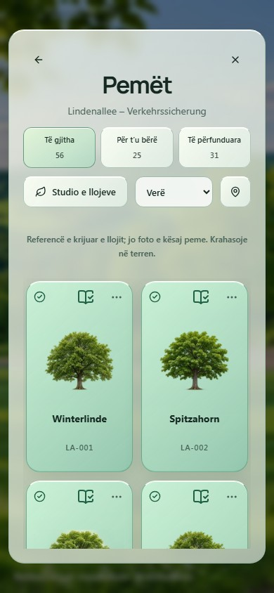

## BauFlow: connected offices, factory and site · 12 November 2026

**Task journal · 13 November 2026.** Personal crystal cards with title, status,
importance and an optional note; complete, edit and archive from the card.
Opt-in reminders belong only to the person who schedules them and use company
time. The configured server sends through the existing push channel even when
the app is closed. Device permission and network/OS delivery still apply;
correlation of the physical iPhone check with a scheduled reminder remains pending.
Company sign-in is required; this is not enabled in the public demo.
Released in PR #191,
production revision 3b327f8.
The existing captures below show the previously accepted 12 November version.

A calendar on the wall, documents in a drawer and an assistant on the monitor. Each team member opens a personal workspace with the tools and information they are allowed to use.

Reception connects the team’s offices. Start/Stop reflects actual working presence. Internal mail with attachments, personal tasks and work assigned by administration. Personal assistants use the employee’s context and permissions; the management assistant stays separate.

Kilograms by day and project, with confirmation evidence. Part cutting, assembly cutting and assembly are separate processes; they are not added together as one steel total.

Owners and administrators manage the company. Engineers work within their role and site permissions; office and field staff see the functions they are authorized to use.

BauFlow is in real operational use at AL-Steel. Screens here use fictitious data; operational access requires a company account. AI, GPS and notifications depend on configuration and device permissions.

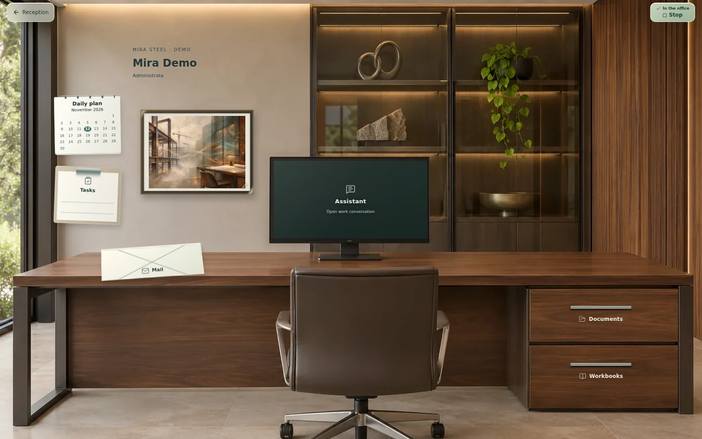

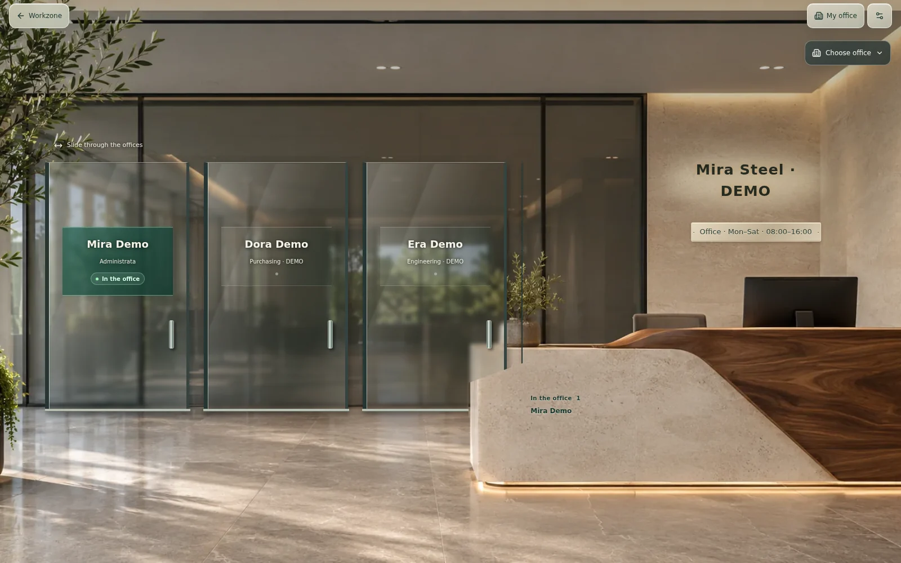

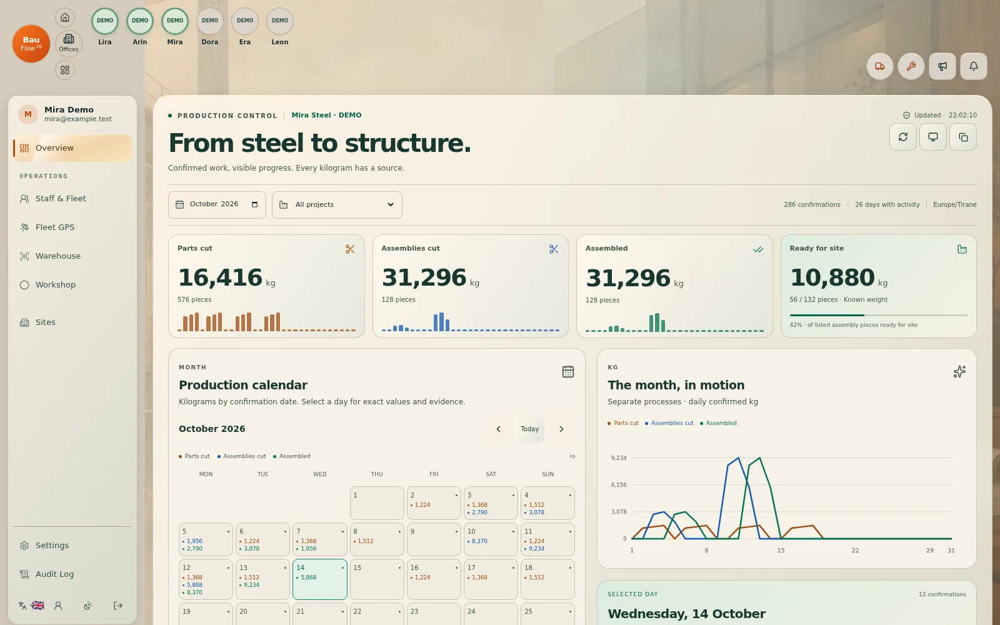

Verified application baseline: d2846d1 · [Product presentation](https://www.baumdienstflow.de/bauflow/about/en.html). The older public fibre-construction demo does not show this office version. External email is not included.

## Document handovers and asset codes in BauFlow

Six site phases group documents with download and a share chooser. Active staff
personally confirm receipt with their name and timestamp. New
versions retain previous files and confirmations in history; receiving a document
does not complete a production step.

Factory barcodes and QR payloads retain leading zeroes, case and punctuation.
A shared model code requires choosing the individual unit. Each unit gets a
unique printable label, while existing codes remain valid. Company sign-in is
required. Physical camera and printer acceptance remain separate from local
browser verification.

This capture comes from the local application with entirely synthetic data.
This documentation PR is published with the approved application update; it does
not enable the private workflows in the public demos.

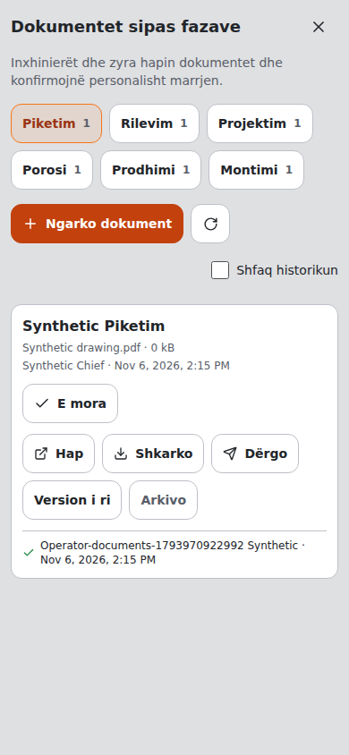

## Site access in BauFlow

Workers read site documents and confirm their own receipt. Office staff upload;
engineers need an explicit upload grant for each site. Management selects them
when creating the site or later under **Access**. Factory and field work keep
their respective engineer roles. Administrators and owners manage the company.
An owner name/PIN login is configured privately inside the signed-in profile.

Local checks cover granting, revocation, competing changes and tenant boundaries.
The image contains only fictional data. Publication and real-account setup follow
the application release approval separately; public demos receive no private data.

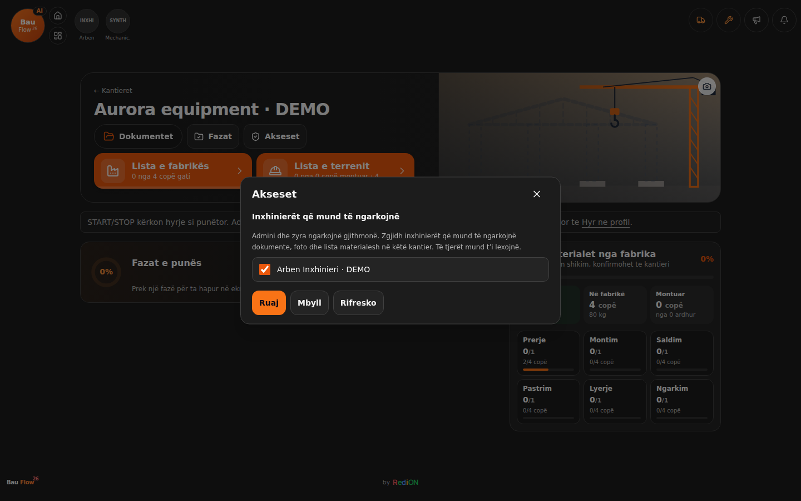

## BauFlow: vehicle card and service workflow

The vehicle card brings together data editing, photo and document expiry dates. Its workshop action opens defect reporting or the exact service history; the full workspace groups compact cards by repair phase. Mechanics or management progress the work, with evidence and invoices retained for the correct job. This capture and browser verification use synthetic data only. This does not enable the private company workflows in the public demos.

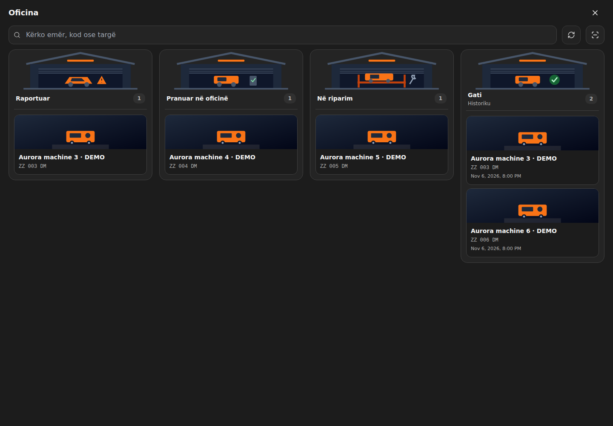
