# Verlauf (Änderungsprotokoll)

## Werkstatt, Lager und Flotte im selben Arbeitsraum · 16.11.2026

**[BauFlow Musterbau](https://bauflow-production-1344.up.railway.app/muster)** und **[RheinRuhr Kranservice Muster](https://rheinruhr-kran-muster-production.up.railway.app/muster)** öffnen die drei Bereiche jetzt direkt unter derselben Team- und Symbolleiste. Kontinuierliche Räume, kompaktes Day/Night-Glas, aufklappbare Suche und die bestehenden Detailkarten behalten die Identität und Daten der jeweiligen Firma.

PR226 läuft als `d174709`, PR227 als `84048b1`. 35 Online-Prüfungen bestanden auf Desktop und emuliertem Handy, in Light/Night, einschließlich Suche, Details, Fokus, natürlichem Footer und verweigertem Lagerzugang für Außenteams. AL-Steel, BaumdienstFlow und andere Demos wurden nicht veröffentlicht oder verändert. Nachweise und Grenzen.

Echte Online-Aufnahmen mit ausschließlich fiktiven Daten · 16. November 2026.

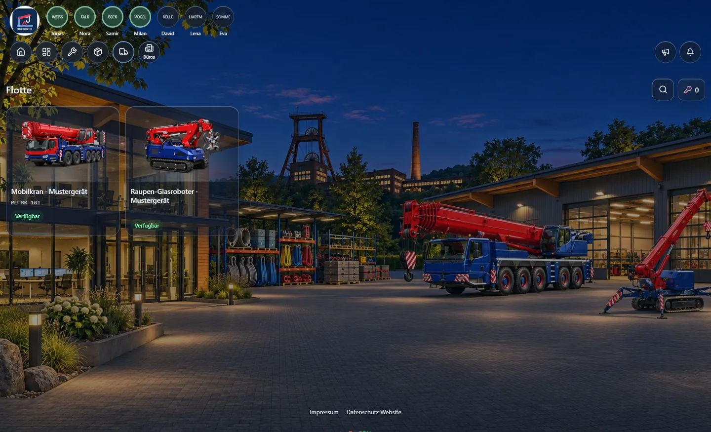

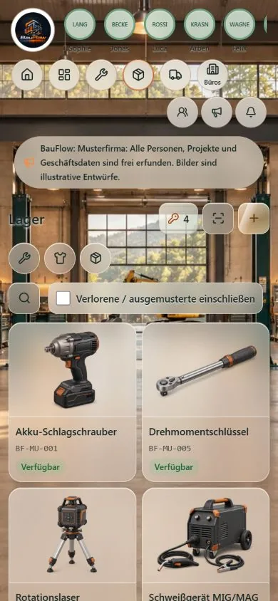

## Eigenständige Kran-Musterfirma ist online · 15.11.2026

**[RheinRuhr Kranservice · MUSTER öffnen](https://rheinruhr-kran-muster-production.up.railway.app/muster)** — ein weiterer fiktiver Betrieb aus der BauFlow-Basis: sieben Mitarbeitende, drei Hebeeinsätze, zwei Maschinen, vier Werkzeuge und drei Büros. Die Fertigung ist deaktiviert. Geschäftsführung, Buchhaltung, Disposition, Außenteam und Werkstatt haben getrennte Zugänge mit den bestehenden Rollenrechten. Änderungen und Dokumente bleiben in der eigenen Datenbank gespeichert; bitte ausschließlich Testdaten eingeben.

PR223 plus Veröffentlichungsadapter PR224, Runtime `a2a5829`: 1.314 Unit-Tests, 36 lokale und 42 Online-Browserfälle bestanden. Ein hochgeladenes PDF blieb nach der erneuten Bereitstellung erhalten und wurde aus einer unabhängigen Mitarbeiter-Sitzung heruntergeladen. AL-Steel, BauFlow Musterbau und BaumdienstFlow behalten ihre bisherigen unabhängigen Deployments. AI, E-Mail, GPS und technische Hebeplanfreigaben sind hier nicht verbunden. [Veröffentlichung und genaue Grenzen](CRANE_MUSTER.md).

Echte Online-Aufnahmen mit fiktiven Daten · 15. November 2026. Die Handyansicht ist emuliert; Bilder sind illustrative Muster, keine technische Einsatzfreigabe.

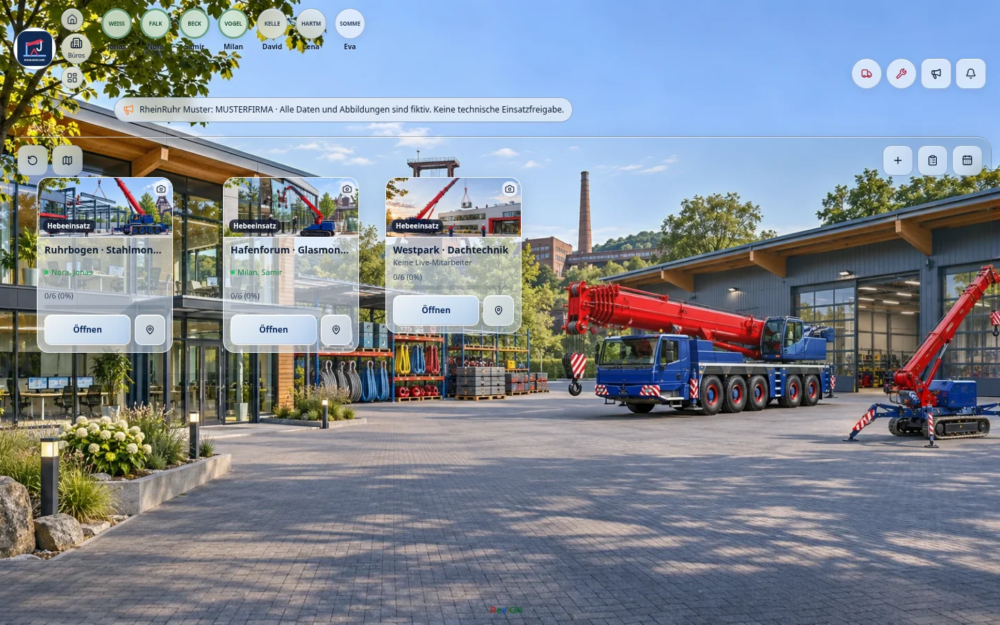

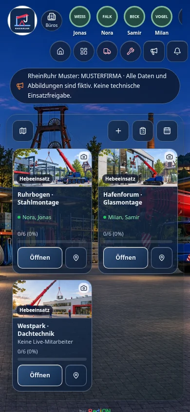

## BauFlow-Musterbetrieb ist online · 14.11.2026

Der eigenständige **[BauFlow Musterbau · DEMO](https://bauflow-production-1344.up.railway.app/demo)** nutzt die aktuelle Stahlbau-Anwendung mit der eigenen originalen BauFlow-Identität. Am Eingang stehen Geschäftsführung, Buchhaltung, Baustelle, Werkhalle und Werkstatt zur Wahl. Zwölf erfundene Mitarbeitende, fünf Büros, drei Baustellen, eine Werkhalle und elf Betriebsmittel (sechs Fahrzeuge und fünf Werkzeuge) sind miteinander verbunden. Änderungen bleiben gespeichert und sind für andere Testende sichtbar; bitte nur Testdaten verwenden. AL-Steel und BaumdienstFlow behalten ihre unabhängigen Deployments.

Veröffentlichung, Zugang und Prüfstand. Erste PR206-Veröffentlichung: `67cd096`; 1.265 Unit-Tests und 45 Browserfälle bestanden. Die folgenden echten Online-Aufnahmen vom 14. November enthalten fiktive Daten. Die Handyansicht ist responsiv/emuliert, keine Abnahme auf einem physischen Gerät.

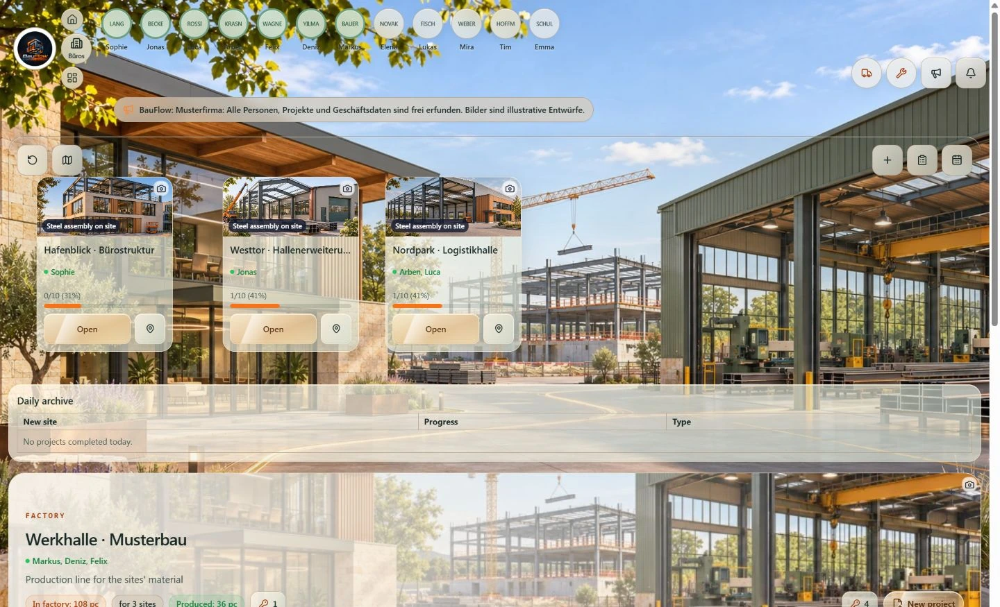

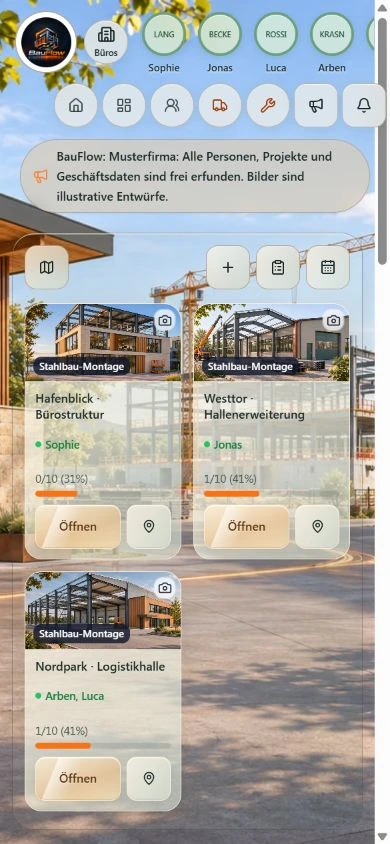

Die Flotte zeigt jetzt sechs bebilderte Musterfahrzeuge in klarem Day/Night-Glas, darunter Kran-LKW und Bauleiter-Kombi. PR211 läuft nur in der eigenständigen Musterfirma-Demo. Hochgeladene Fotos, ursprüngliche Fahrzeugdaten und die Reparaturhistorie bleiben erhalten.

Echte Online-Oberfläche mit fiktiven Daten und illustrativen Fahrzeugbildern · 14. November 2026.

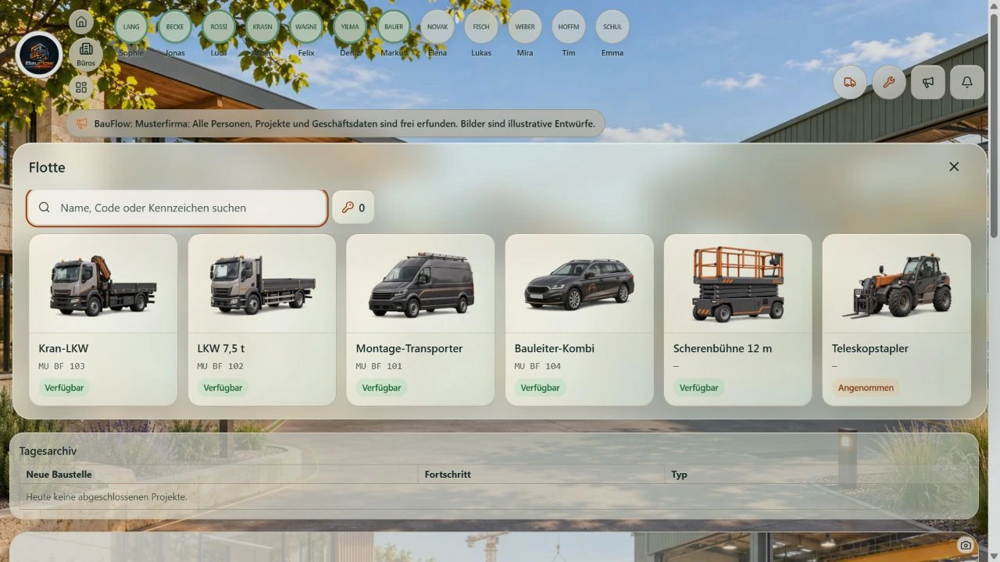

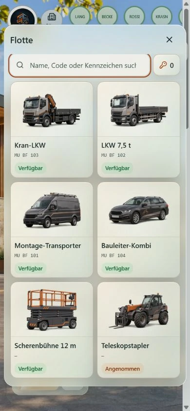

Auch das Lager nutzt jetzt dieselben kompakten Day/Night-Glaskarten mit fünf bebilderten Werkzeugen. PR212 ist nur in der eigenständigen Musterfirma-Demo veröffentlicht; IDs, Barcodes, Übergaben und die bestehende Reparatur bleiben erhalten.

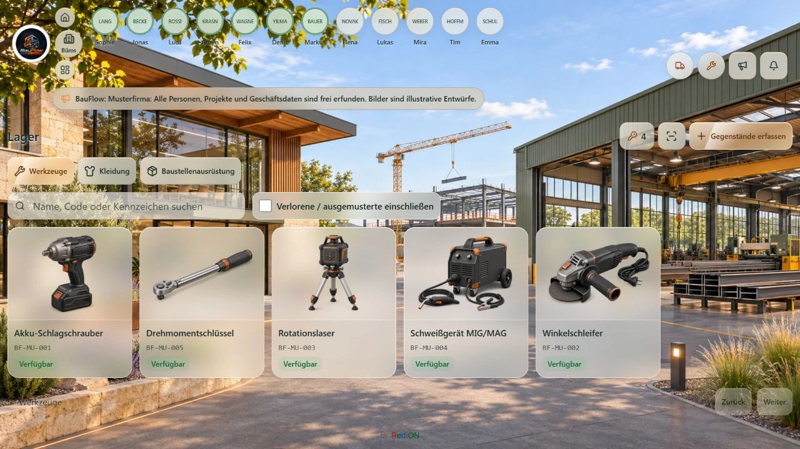

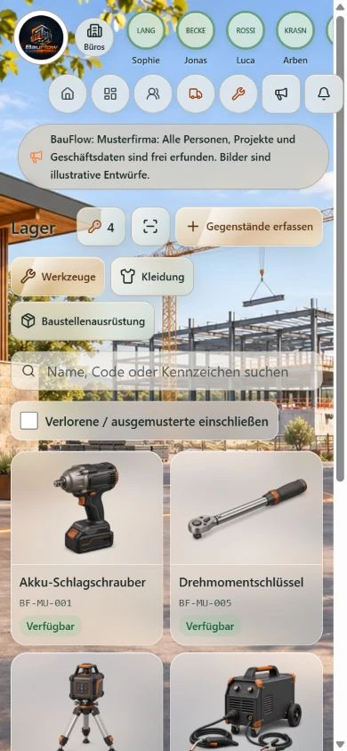

## Musterfirma: fotorealistische Baumreferenzen · 15. November 2026

Die Baumkarten behalten ihre feste Größe und drehen sich für Erledigt/Problemmeldungen. Die Filter stehen frei ohne zusätzliche weiße Leiste; Scrollen bleibt mit ausgeblendeter Scrollbar möglich. Der Artenatlas und die Karten teilen 26 erzeugte fotorealistische Referenzen für Sommer, Herbst und Winter. Es sind Artenillustrationen, keine Fotos der konkreten Baustellenbäume.

Lange Baumlisten montieren nur das sichtbare Fenster mit kleinem Puffer. Inventar und Holzansichten verwenden dieselbe Technik für große Sammlungen; bestehende Datenlimits und Funktionen bleiben erhalten. Quelle und Prüfstand: PR217. Live nur in Musterfirma: Quelle `99c69ee`, Railway `53240831-27cb-4988-aed4-cd733ca44ec8`, SUCCESS/Online. 62 Browserabläufe verifiziert; 727 Unit-Tests und 19 simulierte Integrationsfälle bestanden. Daten und Konfiguration bleiben erhalten.

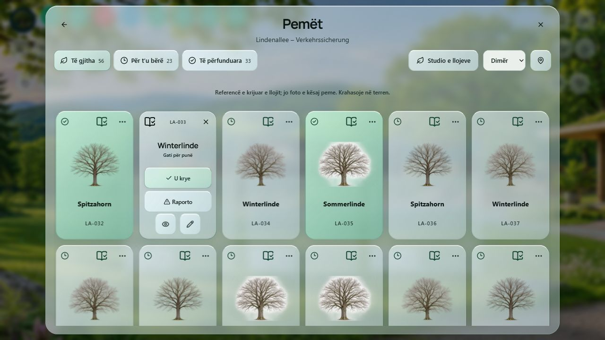

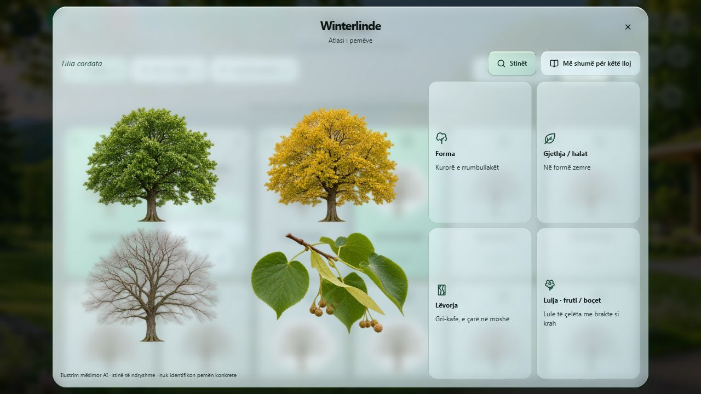

## Musterfirma: Baustellen als Glaskarten · 14. November 2026

Die öffentliche BaumdienstFlow-Musterfirma öffnet Baustellen jetzt als Glaskarte über der bestehenden Workzone: Name, Adresse und Angaben in einer ruhigen Übersicht. Eine illustrierte Baumkarte öffnet die eigene Baumansicht mit **Alle / Zu erledigen / Erledigt**, Karte und Artenstudio. Geräte, Team, Absicherung, Fotos, Prozesse, Dokumente und Unterweisung öffnen getrennte Ansichten.

[Baustellenkarte live öffnen](https://redionflow-production.up.railway.app/demo/baustellen/cmw5rbbq1000o2kk19w9m2apf). Die folgenden Ansichten zeigen die aktuelle Demo-Oberfläche mit ausschließlich fiktiven Daten; sie ändern keine Firmenzugänge anderer Produkte. Die bestehenden Daten und Dateien wurden bei der Veröffentlichung unverändert erhalten. Quelle: a7093cf, PR205.

Aktuelle Ansichten vom 15. November 2026: fotorealistische Baumreferenzen und derselbe Glasstil. Die Telefonansicht nutzt fiktive, schreibgeschützte Demodaten.

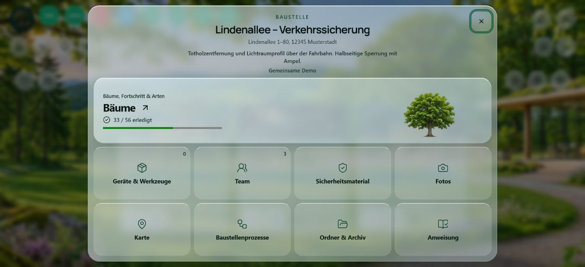

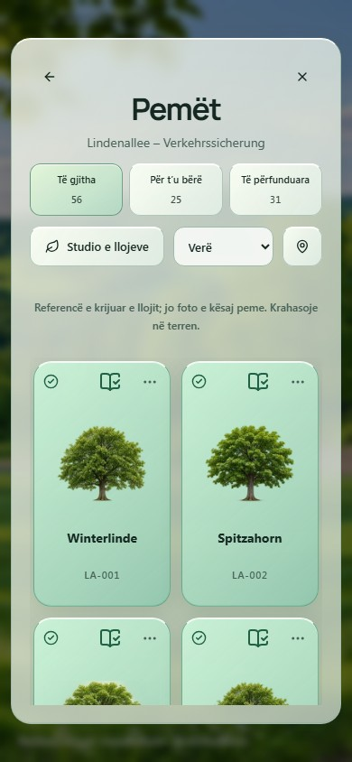

## BauFlow: vernetzte Büros, Fertigung und Baustelle · 12. November 2026

**Aufgabenjournal · 13. November 2026.** Persönliche Kristallkarten mit Titel,
Status, Wichtigkeit und optionaler Notiz; erledigen, bearbeiten und archivieren
direkt aus der Karte. Freiwillige Erinnerungen gelten nur für die Person, die
sie setzt, und verwenden die Firmenzeit. Der eingerichtete Server sendet auch
bei geschlossener App über den vorhandenen Push-Kanal. Gerätefreigabe und
Netz/OS bleiben Voraussetzung; die genaue Zuordnung der physischen iPhone-Probe
zu einer geplanten Erinnerung steht noch aus. Firmenzugang erforderlich,
keine Freischaltung in der öffentlichen Demo. Veröffentlicht mit
PR #191,
Produktionsrevision 3b327f8.
Die bestehenden Aufnahmen unten zeigen den zuvor abgenommenen Stand vom 12. November.

Kalender an der Wand, Dokumente in der Schublade und der Assistent auf dem Monitor. Jedes Teammitglied öffnet seinen Arbeitsraum mit den erlaubten Werkzeugen und Informationen.

Der Empfang verbindet die Teambüros. Start/Stopp zeigt die tatsächlich erfasste Arbeitspräsenz. Interne Post mit Anhängen, persönliche Aufgaben und Aufträge der Verwaltung. Persönliche Assistenten nutzen den Kontext und die Rechte des Mitarbeiters; der Führungsassistent bleibt getrennt.

Kilogramm nach Tag und Projekt, mit Nachweisen der Bestätigungen. Teilezuschnitt, Baugruppenzuschnitt und Zusammenbau sind getrennte Prozesse; sie werden nicht zu einer einzigen Stahlmenge addiert.

Inhaber und Administratoren verwalten das Unternehmen. Ingenieure arbeiten nach Rolle und Baustellenrechten; Büro- und Außenteams sehen ihre freigegebenen Funktionen.

BauFlow ist bei AL-Steel im realen Betrieb. Die Ansichten hier zeigen fiktive Daten; der operative Zugang erfordert ein Firmenkonto. KI, GPS und Benachrichtigungen hängen von Konfiguration und Gerätefreigaben ab.

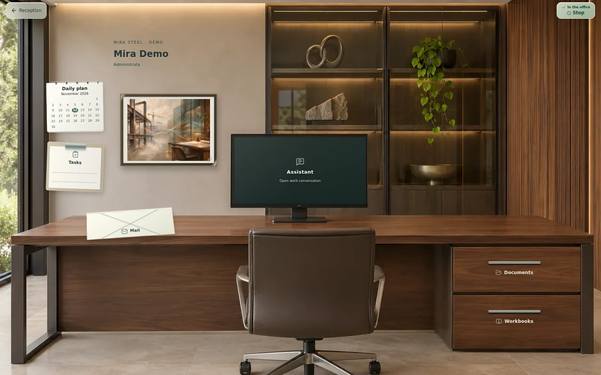

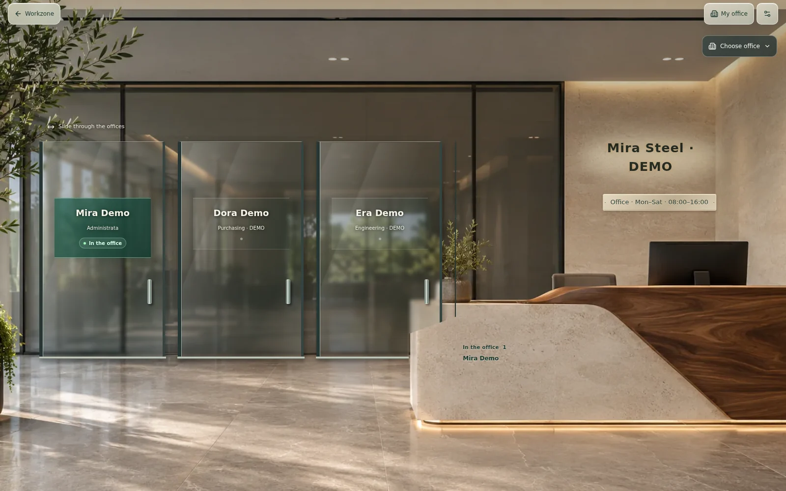

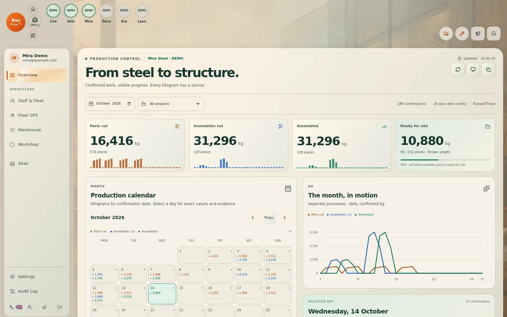

Verifizierte App-Basis: d2846d1 · [Produktpräsentation](https://www.baumdienstflow.de/bauflow/about/de.html). Die ältere öffentliche Glasfaser-Demo zeigt nicht diese Büroversion. Externe E-Mail ist nicht enthalten.

## Dokumentübergabe und Gerätecodes in BauFlow

Sechs Baustellenphasen bündeln Dokumente mit Download und Teilen-Dialog.
Aktive Mitarbeitende bestätigen den Empfang persönlich mit Name und Zeitpunkt.
Neue Dateiversionen behalten die alten Dateien und Bestätigungen im Verlauf;
eine Empfangsbestätigung schließt keinen Produktionsschritt ab.

Hersteller-Barcodes und QR-Codes bleiben lesbar, auch mit führenden Nullen,
Groß-/Kleinschreibung und Satzzeichen. Ein gemeinsamer Modellcode verlangt die
Auswahl des einzelnen Geräts. Jedes Gerät erhält eine eigene druckbare Etikette;
bisherige Codes bleiben gültig. Firmenanmeldung erforderlich. Kamera und Drucker
am realen Gerät werden getrennt von der lokalen Browserprüfung abgenommen.

Die Aufnahme stammt aus der lokalen Anwendung mit ausschließlich synthetischen
Daten. Diese Dokumentations-PR wird erst mit der freigegebenen App-Erweiterung
veröffentlicht; sie schaltet die privaten Abläufe nicht in den öffentlichen Demos frei.

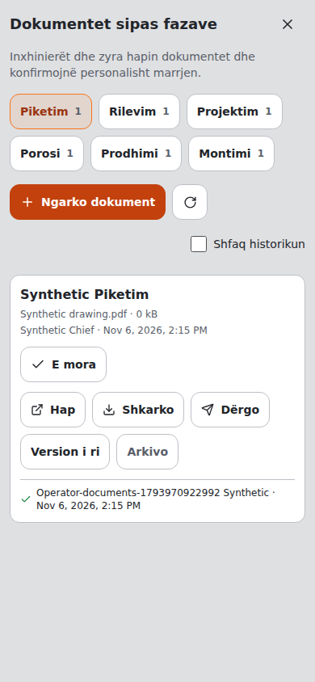

## Baustellenrechte in BauFlow

Mitarbeitende lesen Baustellendokumente und bestätigen ihren eigenen Empfang.
Das Büro lädt Dokumente hoch; Ingenieure brauchen dafür eine explizite Freigabe
je Baustelle. Die Leitung wählt sie beim Anlegen oder später unter **Zugriff**.
Fabrik- und Baustellenschritte folgen weiterhin der jeweiligen Ingenieurrolle.
Administratoren und Inhaber verwalten den Betrieb. Ein eigener Name/PIN-Zugang
für Inhaber wird privat im angemeldeten Profil eingerichtet.

Die lokale Prüfung deckt Erteilung, Entzug, konkurrierende Änderungen und
Mandantengrenzen ab. Das Bild zeigt ausschließlich fiktive Daten. Veröffentlichung
und Einrichtung realer Konten erfolgen getrennt nach Freigabe der App-Version;
die öffentlichen Demos erhalten dadurch keine privaten Firmendaten.

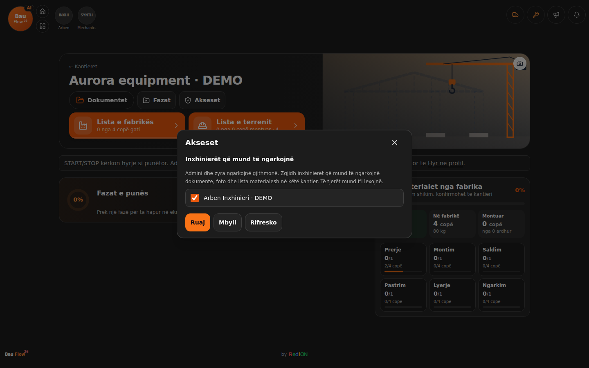

## BauFlow: Fahrzeugkarte und Serviceablauf

Die Fahrzeugkarte bündelt Datenbearbeitung, Foto und Dokumentfristen. Die Werkstattaktion am Fahrzeug öffnet Defektmeldung oder den genauen Serviceverlauf; die Vollansicht zeigt kompakte Karten nach Reparaturphase. Mechanik oder Leitung schalten weiter, Belege und Rechnungen bleiben beim jeweiligen Auftrag. Die Aufnahme und Browserprüfung nutzen ausschließlich synthetische Daten. Die privaten Firmenabläufe werden damit nicht in den öffentlichen Demos freigeschaltet.

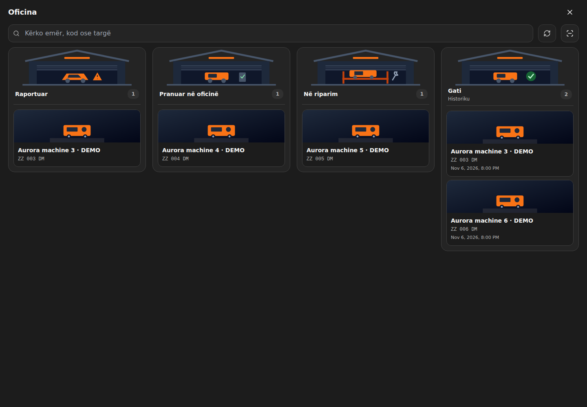
